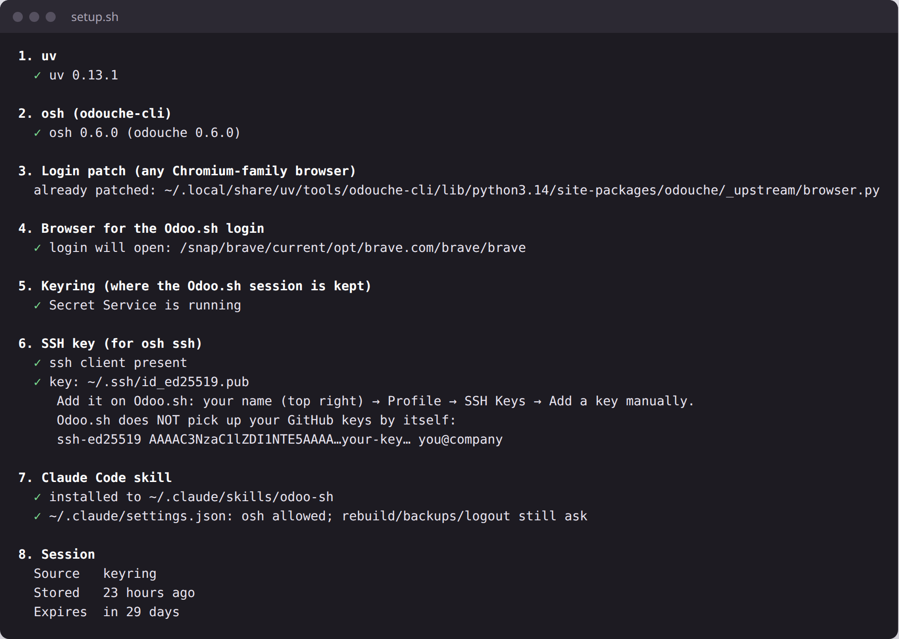
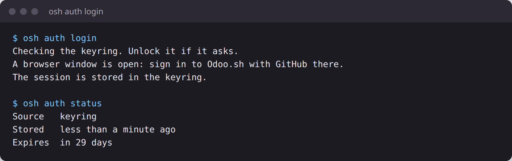
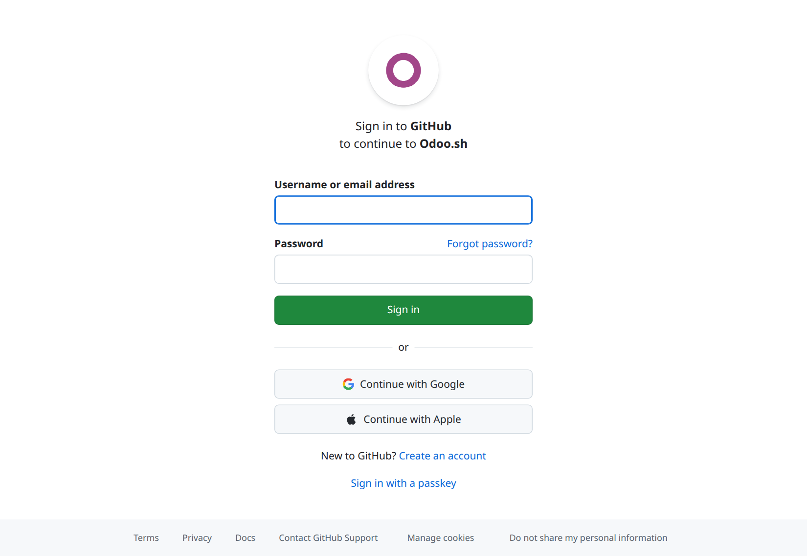
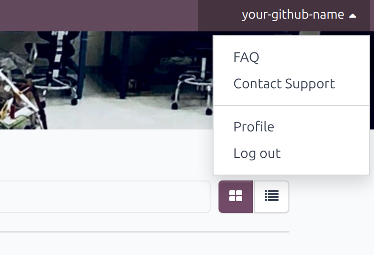
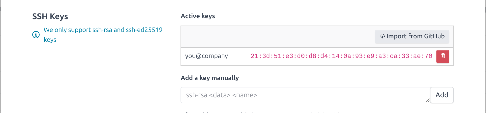
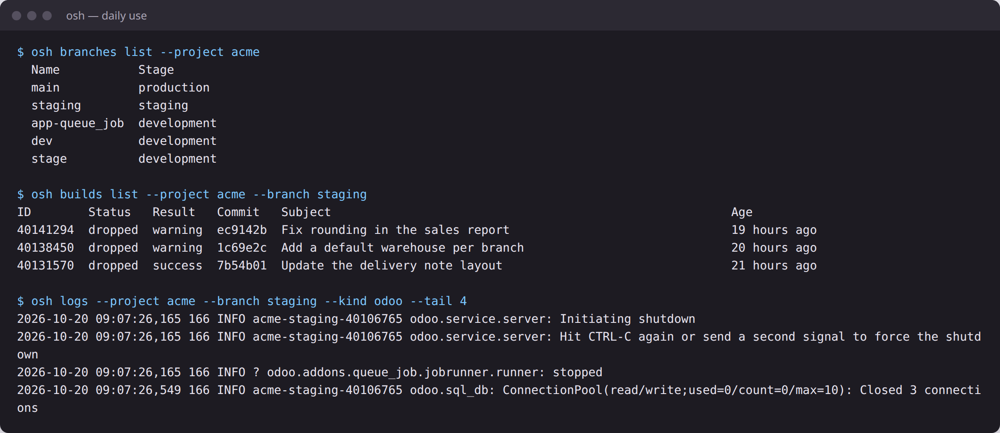
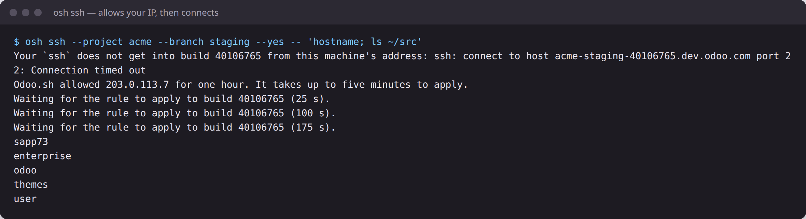

# odoo-sh — Odoo.sh from your terminal and from Claude Code

See Odoo.sh without opening the web page: projects, branches, builds, build and server logs
(live), backups, and an SSH shell on a build — including the "Allow my IP" step that staging and
production now need. Claude Code gets the same view through this skill, so it can push, watch the
build, read the traceback and fix it on its own.

Built on [odouche](https://github.com/avanserv/odouche) (unofficial, MIT, by Avanserv). This repo
adds a Claude Code skill, a one-shot setup, and a login fix so it works with any Chromium-family
browser — see [What this adds](#what-this-adds-over-odouche).

> Odoo.sh has no public API. odouche uses what the Odoo.sh web page uses, so an Odoo.sh change can
> break it until odouche catches up. It then fails with a clear error, never wrong data.

## What you need

| | |
|---|---|
| System | Linux, macOS, or Windows through WSL. Native Windows works too, with the cookie login |
| Odoo.sh access | Your GitHub account is a collaborator on the Odoo.sh projects |
| Keyring | Linux: GNOME Keyring or any Secret Service (Ubuntu has it). macOS: Keychain |
| Browser | Any Chromium-family browser for the one-click login — [table below](#which-browser-does-the-login-use). Firefox or Safari only → [cookie login](#login-without-a-chromium-browser) |

## Install

### 1. Clone into your Claude skills and run the setup

```bash
git clone https://github.com/GlobalOdoo/odoo-sh-skill.git ~/.claude/skills/odoo-sh
~/.claude/skills/odoo-sh/scripts/setup.sh --claude-permissions
```

The script installs [`uv`](https://docs.astral.sh/uv/) and `osh`, makes the login work with your
browser, checks your keyring and SSH key, and installs the skill. `--claude-permissions` stops
Claude Code's auto mode blocking `osh`; rebuilds, backups and logout still ask you first. It is
safe to run again.

Want a specific browser?

```bash
~/.claude/skills/odoo-sh/scripts/setup.sh --browser brave   # chrome | chromium | brave | edge | vivaldi | opera | /full/path
```



### 2. Log in once — it lasts 30 days

```bash
osh auth login
```

A browser window opens on GitHub's sign-in page. Sign in with the GitHub account you use for
Odoo.sh within 5 minutes. The terminal then says **"The session is stored in the keyring."**





> **Why the window looks empty** — no saved logins, no Bitwarden or 1Password: odouche opens a
> brand-new temporary profile on purpose and deletes it afterwards. It never touches your everyday
> browser profile, which holds your sessions for every other site. Type your GitHub password there,
> or copy it from your password manager's desktop or phone app.

### 3. Add your SSH key on Odoo.sh — only for `osh ssh`

Odoo.sh keeps its own list of SSH keys; it does **not** pick up the ones on your GitHub account by
itself.

1. Copy your public key — setup printed it, or `cat ~/.ssh/id_ed25519.pub`
   (none yet? `ssh-keygen -t ed25519 -C "you@company"`).
2. On [www.odoo.sh](https://www.odoo.sh/project), click your name at the top right → **Profile**.

   

3. Under **SSH Keys**, paste the key into **Add a key manually** → **Add**. If the key is already
   on your GitHub account, **Import from GitHub** does the same. It works within a minute or two.

   

### Update

```bash
git -C ~/.claude/skills/odoo-sh pull
~/.claude/skills/odoo-sh/scripts/setup.sh
```

Run `setup.sh` again after `uv tool upgrade odouche-cli` too — the upgrade removes the login fix.

## Use it

In Claude Code, just ask — the skill loads by itself:

- "Did the staging build pass?"
- "Push, watch the build, and if it fails, read the log and fix it."
- "Follow the production log while I confirm this order."
- "SSH into staging and check the module version."

Inside a client repo, `osh` finds the project and branch from git. By hand:

```bash
osh projects list
osh branches list --project <project>
osh builds list --project <project> --branch <branch>
osh builds watch                  # waits for the build, exits with its result
osh logs --kind odoo -f           # follow the server log live
osh backups list --project <project>
osh ssh --branch <staging>        # allows your IP for 1 hour if needed
```





Staging refused the first try, `osh` pressed "Allow my IP", and the command ran once the rule
applied — about 3 minutes here. (Project name and IP replaced with examples.)

### What Claude may do on its own

With `--claude-permissions`, and by the rules in [`SKILL.md`](SKILL.md):

| Free | Asks you first |
|---|---|
| List projects, branches, builds, backups | `osh builds rebuild` — and **never** on production |
| Read and follow build and server logs | `osh backups create`, `download`, `pull` |
| Wait for a build | Anything that changes a build over SSH |
| Read-only SSH on staging and development | Any SSH on production, even reading |
| | `osh auth logout` |

## Which browser does the login use?

Any Chromium-family browser on the machine. Setup picks one; `--browser` or `OSH_BROWSER` overrides.

| Browser | Login | Notes |
|---|---|---|
| Brave | One click | Including the Ubuntu snap — tested |
| Google Chrome | One click | deb, rpm or macOS app |
| Chromium | One click | deb, or the snap |
| Microsoft Edge | One click | |
| Vivaldi, Opera | One click | Chromium-based; not tested yet |
| Firefox, Safari | Cookie login | No Chromium engine |
| Flatpak browsers | Cookie login | The sandbox hides the browser from `osh` |

## Login without a Chromium browser

For Firefox, Safari, native Windows or a server, `osh auth login` asks for the cookie instead, in
a prompt that hides what you paste:

1. In your own browser, open [www.odoo.sh](https://www.odoo.sh) and log in.
2. Open the developer tools (F12). Firefox: **Storage → Cookies**. Chrome, Edge, Brave:
   **Application → Cookies**. Safari: enable the Develop menu, then **Storage → Cookies**.
3. Under `https://www.odoo.sh`, copy the value of `session_id` and paste it at the `session_id:`
   prompt.

To use this path even when a browser exists: `env -u DISPLAY -u WAYLAND_DISPLAY osh auth login`.

## Windows

Easiest is WSL (Ubuntu) with the Linux steps. Natively, in PowerShell:

```powershell
powershell -ExecutionPolicy ByPass -c "irm https://astral.sh/uv/install.ps1 | iex"
uv tool install odouche-cli
osh auth login        # asks for the session_id cookie
git clone https://github.com/GlobalOdoo/odoo-sh-skill.git $env:USERPROFILE\.claude\skills\odoo-sh
```

The session goes to the Windows Credential Locker; `osh ssh` uses the OpenSSH client built into
Windows 10 and 11.

## Troubleshooting

| You see | Do this |
|---|---|
| `The browser did not open a window to log in from.` | Run `setup.sh` again — usually after `uv tool upgrade odouche-cli` |
| `Not logged in` | `osh auth login` — sessions last 30 days at most |
| The wrong browser opens | `setup.sh --browser <name>` or `export OSH_BROWSER=/path/to/browser` |
| `No browser can be launched here` | Use the cookie login |
| `Permission denied (publickey)` | Your key is missing from Odoo.sh → your name → Profile → SSH Keys |
| `Host key verification failed` | From a script or Claude: add `-- -o StrictHostKeyChecking=accept-new` |
| SSH times out, then "allowed … for one hour" | Normal. The rule takes 1–5 minutes; `osh` keeps trying |
| Keyring error on Linux | `sudo apt install gnome-keyring`, then log out and in |
| Exit code 6, an unexpected answer | Odoo.sh changed: `uv tool upgrade odouche-cli`, then `setup.sh` again |

## What this adds over odouche

| | [odouche](https://github.com/avanserv/odouche) (upstream) | [odoo-sh-toolkit](https://github.com/abdallah-abdelsabour/odoo-sh-toolkit) (fork) | This repo |
|---|---|---|---|
| Base | 0.6.0+ | Snapshot of odouche 0.4.0 | Upstream from PyPI, kept current by `setup.sh` |
| Backups, branch history, log-token scrubbing | Yes | No | Yes (upstream) |
| Staging/production SSH | "Allow my IP", 1 hour, automatic | Edits the permanent project whitelist (10 IPs, whole team) | Upstream's 1-hour allow |
| Login with Brave / Chrome for Testing | Fails: asks for the window once, before it exists | Same | Waits up to 15 s |
| Snap browsers (Ubuntu Brave, Chromium) | Snap Brave not found; snap launchers never answered in our test | Same | Uses the browser inside the snap |
| Choose the browser | No | No | `--browser`, `OSH_BROWSER`, `~/.config/odouche/browser` |
| Vivaldi, Opera | No | No | Yes |
| One-command setup | No | No | `setup.sh`: uv, osh, patch, browser, keyring, SSH key, skill |
| Claude Code skill | No (MCP server only) | No (MCP server only) | Yes — with rules: no production rebuilds, ask before backups |
| Claude auto mode | Can block `osh ssh` (seen as a "production read") | Same | Allow rules + context; writes still ask |
| Agent-safe SSH | `--yes` exists; the host-key prompt still stops an agent | Same | `--yes` + host-key and batch flags, and how to run a script on a build |
| Where SSH keys go | Documented | — | Shown step by step: Odoo.sh profile, not GitHub |

The login fix lives in [`scripts/patch_odouche.py`](scripts/patch_odouche.py). It edits the
installed odouche (marked "odoo-sh skill patch") and refuses to touch a version whose code changed,
so an upstream fix will simply make it unnecessary.

## What's in here

| Path | What it is |
|---|---|
| `SKILL.md` | Instructions Claude Code loads |
| `scripts/setup.sh` | One-shot install and check |
| `scripts/patch_odouche.py` | Login fix: any Chromium-family browser, snap browsers, wait for the window |
| `screenshots/` | The pictures above |
| `NOTICE.md` | odouche's license, for the code the patch adapts |

## Safety

- Your GitHub password and token never pass through odouche. Only the Odoo.sh session is kept, in
  the OS keyring, for 30 days at most.
- The patch only changes which browser odouche starts and how long it waits for its window. It does
  not change what odouche reads from the browser (the `www.odoo.sh` session cookie, nothing else).
